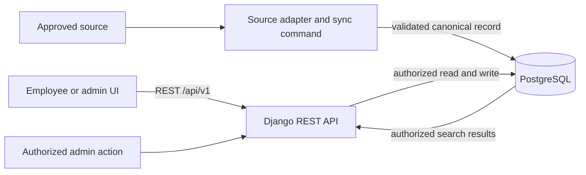

# Architecture Spine — Learning Center

## Purpose

Set the contracts that keep four engineers building compatible parts of Learning Center. The development baseline below is delegated and adopted for local development and the pilot codebase. Identity, data-governance, source-access, and production-hosting decisions remain with their organizational owners.

## Design Paradigm

Use a modular monolith for the Python service and one React SPA client. Django apps follow capability boundaries. All data access passes through the versioned REST API; integrations sit behind source adapters. Do not add services or separate stores until a measured need justifies them.

## Inherited Invariants

None. This is the initiative-level spine.

## Decisions

### AD-1 — [PROPOSED] Keep one canonical learning record boundary

**Binds:** Manual entry, approved imports, and employee search use shared concepts for learning items and, if approved for MVP, employee learning records.

**Prevents:** Search, manual entry, and integrations from inventing incompatible meanings for course, certification, status, or employee identity, or creating duplicate records for the same source item.

**Rule:** Every Learning Center record has an internal identifier. An imported item is uniquely identified by its source connection and source item identifier; the source connection distinguishes its tenant, site, or library. A manual record uses its internal identifier. Possible matches across different sources or manual records are reviewed and never automatically merged. Do not create or import employee-specific records until their record types, approved employee identifier, uniqueness, and duplicate/conflict handling are settled.

### AD-2 — [PROPOSED] Keep integrations behind source adapters

**Binds:** Each external source has an isolated adapter that reads approved source data, maps it to the canonical model, and reports source-specific errors.

**Prevents:** SharePoint details from leaking into the employee search contract or making future sources require rewrites of the core experience.

**Rule:** A source is not supported until its owner, permissions, content shape, and update behavior are verified. Source-owned fields and links are not exposed to employees until the source owner approves and tests the employee access path.

### AD-3 — [PROPOSED] Enforce the approved access policy at the service boundary

**Binds:** Every employee-specific read and write, search result, administrative mutation, and restricted operational view uses the approved identity and role policy on the server.

**Prevents:** UI-only hiding or stale role data from exposing employee records, catalog edits, source status, exports, result counts, or snippets.

**Rule:** Check the current policy for every requested action and each search hit before returning metadata or a snippet. Missing or ambiguous identity and unavailable authorization checks fail closed. Administrative actions remain denied until their permissions are approved.

### AD-4 — [PROPOSED] Make synchronization repeatable and preserve last-good data

**Binds:** Reprocessing a source item updates its mapped record, and partial or failed runs do not silently change the availability of records that were last imported successfully.

**Prevents:** Retry duplication, false deletions from incomplete runs, and administrators or employees mistaking stale data for a successful import.

**Rule:** Key an imported item by source connection and source item identifier. A partial or failed run never treats an absent item as deleted; preserve its last-good state and report the run outcome. Apply deletion or unpublishing only under an approved per-source rule and authoritative source signal, then mark the record withdrawn while retaining provenance and audit history. The initial pilot uses an idempotent Django management command invoked by an approved scheduler; add a queue only if measured workload requires it.

### AD-5 — [PROPOSED] Preserve field ownership and provenance

**Binds:** Each field that can be imported or manually changed has one authoritative owner or an explicit conflict rule before synchronization writes it.

**Prevents:** Imports silently overwriting manual corrections, manual edits being lost on refresh, or records losing their source and change history.

**Rule:** Maintain one approved, versioned field-ownership policy for manual writes and imports. No field is writable from either path until its owner or conflict rule is approved. Source-owned fields change only through their approved source; manually owned fields change only through authorized administration. Conflicts are rejected or sent for review, never resolved by last-write-wins alone. Every record retains its origin, imported source reference where applicable, and creation and last-update actor and time.

### AD-6 — [ADOPTED] Search canonical PostgreSQL records and reauthorize every result

**Binds:** Pilot search reads canonical records from PostgreSQL and applies current authorization before returning results.

**Prevents:** Search divergence from record ownership, stale permissions, and results appearing before the canonical change is committed.

**Rule:** Use PostgreSQL built-in full-text search against the canonical store for the pilot. Use project-local English and Spanish configurations that apply `unaccent` before their stemmer. Source-language metadata is `en`, `es`, `mixed`, or `unknown`; mixed-language items keep both vectors, and unknown-language items use `simple`. Query both English and Spanish configurations regardless of UI locale, plus `simple` for unknown-language items. Return each item once and rank mixed-language matches by their greatest matching rank, then title and ID. Do not translate source text or add a separately maintained search service until measured volume or latency requires one. Return no hit, count, snippet, or detail if authorization cannot be checked. A committed change is searchable from the canonical store; show source synchronization freshness separately. If a separate search index is introduced later, expose its freshness, retries, and stale state before relying on it. Implementation detail and acceptance example live in shared-contracts.md and the search ticket.

### AD-7 — [PROPOSED] Prefer approved metadata and links over file copies

**Binds:** The initial design stores approved metadata and source links; copying source files requires a separate retention, permission, and ownership decision.

**Prevents:** Unapproved duplication of corporate documents and access that outlives the source policy.

**Rule:** Do not show imported content, restricted metadata, or source links until the source owner approves and tests a per-user access path. If source authorization cannot be verified for an employee, omit the item and link from employee results.

### AD-8 — [ADOPTED] Use Python for the backend and React for the frontend

**Binds:** Backend application code uses Python; employee and administrator interfaces use React.

**Prevents:** Separately built epics choosing incompatible implementation languages.

**Rule:** Use Python for backend code and React for frontend code. The concrete frameworks and versions are set by AD-11.

### AD-9 — [ADOPTED] Target WCAG 2.2 Level AA

**Binds:** Employee and administrator interfaces meet the selected accessibility target in addition to the existing UX floor.

**Prevents:** Independently built screens from using inaccessible controls or interpreting accessibility as optional polish.

**Rule:** Target WCAG 2.2 Level AA. Support keyboard navigation, semantic labels, visible focus, assistive-technology announcements for changing results and validation, and status cues that do not rely on color alone.

### AD-10 — [ADOPTED] Gate production employee data on organizational approval

**Binds:** Manual entry, source imports, storage, indexing, and search of real employee-linked data in production.

**Prevents:** Production processing before data and regional approvals are recorded.

**Rule:** Do not load, store, index, or expose real employee-linked data in production until the organization records approval for data classification, access rules, retention, and regional handling. Use synthetic data locally and only approved test data in approved non-production environments.

### AD-11 — [ADOPTED] Use one Django API and one React Router SPA in a monorepo

**Binds:** Four engineers share one local-development baseline and one API contract.

**Prevents:** Competing frameworks, duplicated data stores, incompatible routes, and frontend code bypassing server authorization.

**Rule:** Keep `backend/` and `frontend/` in this repository. Use Python 3.14.10, Django 5.2.19 LTS, Django REST framework 3.18.3, PostgreSQL 18.6, Node.js 26.13.1 LTS, React 19.3.0, React Router 8.5.1 Framework Mode with SPA rendering, Vite 8.3.8, and uv 0.13.2. Node 26 is the current Active LTS line; choose it for a supported current baseline. Pin Python, Node, and uv in checked-in project metadata. Manage Python dependencies with uv and uv.lock; manage frontend dependencies with npm and package-lock.json. Use Django REST endpoints under `/api/v1/`; the browser client uses origin-relative paths through a Vite development proxy bound to loopback. Run PostgreSQL locally through Compose. Keep production hosting, network topology, identity provider, and data region deferred to organizational approval.

### AD-12 — [ADOPTED] Provide English and Spanish interface text

**Binds:** Employee and administrator screens and common system messages use the same locale contract.

**Prevents:** Four developers choosing inconsistent language behavior or translating source records differently.

**Rule:** Support English and Spanish in the user interface with a visible, user-selectable locale. Do not infer language solely from country, automatically translate source content, or rewrite a record's original language during import. Use the browser language only as the initial preference when no user preference exists.

### AD-13 — [ADOPTED] Keep local identity and data synthetic

**Binds:** Local development and example fixtures used while the organization is deciding identity and access.

**Prevents:** Real employee data or a development identity shortcut being mistaken for production access control.

**Rule:** Local fixtures use synthetic employees and records only. A development identity adapter must be disabled outside local development and must not be presented as production authentication. Production authentication is supplied by the identity provider approved under AD-3.

### AD-14 — [ADOPTED] Share a versioned API and local SPA routing contract

**Binds:** The React client and Django service use one request path and stable JSON behavior across independently built stories.

**Prevents:** Hard-coded origins, duplicate API conventions, inconsistent pagination, and development-only routing that cannot be reviewed.

**Rule:** The browser calls origin-relative routes under `/api/v1`. Vite proxies those routes to Django in local development and serves a client-route fallback. Production routes `/api/v1` to Django and other app routes to the SPA only after the hosting design is approved. Payload and error conventions live in shared-contracts.md.

### AD-15 — [ADOPTED] Keep interface locale separate from source language

**Binds:** UI copy, imported text, and search behavior across English and Spanish.

**Prevents:** Changing source content or narrowing search because a user changed the interface language.

**Rule:** Support `en` and `es` as selectable UI locales. Preserve source text and language metadata; do not translate it automatically. UI locale never implicitly filters search. Search approved English and Spanish catalog text using the language metadata defined by the field dictionary.

### AD-16 — [ADOPTED] Lock dependencies and keep local setup reproducible

**Binds:** The four engineers install the same backend, frontend, and database baseline.

**Prevents:** Unreviewed transitive-version drift and environment-specific setup assumptions.

**Rule:** Use `uv.lock` for Python and `package-lock.json` with npm for the frontend. Pin Python 3.14.10 in `.python-version`, Node.js 26.13.1 in `.nvmrc`, and uv 0.13.2 with `tool.uv.required-version`. Run PostgreSQL 18.6 through Compose. Story 5.1 creates the manifests and records exact install, startup, and manual smoke-check commands; do not claim those commands exist before then.

## Consistency Conventions

| Concern | Convention |
| --- | --- |
| API routes | Version all application endpoints under `/api/v1/`; use JSON request and response bodies. |
| Source identifiers | Keep internal IDs separate from source-connection and source-item identifiers. |
| Dates and locale | Store timestamps in UTC; display in the selected user locale. Keep imported source text unchanged. |
| Authorization | Enforce server-side on every read, write, search hit, count, snippet, and restricted operations view. |
| Configuration | Read secrets and environment-specific settings from environment variables; commit only `.env.example`. |
| Error and sync state | Return actionable API errors; preserve last-good imported data on failed or partial syncs. |
| API | Use origin-relative JSON endpoints under `/api/v1`; response, pagination, and error shapes are in `shared-contracts.md`. |
| Locale and search | Keep UI locale separate from source language; do not translate source text or filter search by UI locale. |

## Stack

| Name | Version |
| --- | --- |
| Python | 3.14.10 |
| Django | 5.2.19 LTS |
| Django REST framework | 3.18.3 |
| PostgreSQL | 18.6 |
| Node.js | 26.13.1 LTS |
| React | 19.3.0 |
| React Router | 8.5.1 Framework Mode |
| Vite | 8.3.8 |
| Python package manager | uv 0.13.2 with `uv.lock` |
| Frontend package manager | npm with `package-lock.json` |

## Structural Seed

Initial repository layout:

```text
Equipo8/
  backend/     Django REST API and source adapters
  frontend/    React Router SPA
  _bmad-output/ planning, decisions, and tickets
  compose.yaml local PostgreSQL service
```

Provisional components:

1. React Router Framework Mode SPA in `frontend/`.
2. Django REST Framework API in `backend/`.
3. PostgreSQL as the canonical store and pilot full-text search engine.
4. Manual administration flow with validation and attribution.
5. Source adapter and idempotent synchronization management command.
6. Authorization policy shared by API reads, writes, search, and operational views.

Data flow: a source adapter or administrator submits a change; the API validates permission and field ownership; the canonical PostgreSQL record is committed; employee search queries that store through the same authorization boundary. Source status is reported independently from search.



## Capability → Architecture Map

| Capability / Area | Lives in | Governed by |
| --- | --- | --- |
| Local application foundation and shared catalog schema (RULE-1, RULE-3, RULE-6) | Django API, React SPA, Compose database, and canonical LearningItem model | AD-1, AD-5, AD-11, AD-14, AD-16 |
| Employee search and filters (R1) | React routes and Django search API | AD-3, AD-6, AD-8, AD-9, AD-11, AD-12 |
| Employee identity and personal records (R2) | Django authorization boundary and record service | AD-1, AD-3, AD-10, AD-13 |
| Manual administration (R3) | Django record service and React admin routes | AD-3, AD-5, AD-8, AD-9, AD-11 |
| Approved source import (R4) | Django source adapter and sync command | AD-2, AD-4, AD-5, AD-7, AD-10, AD-11 |
| Sync health (R5) | Django operational API and React admin route | AD-3, AD-4, AD-9, AD-11 |

## Deferred

- CI provider and approved non-production deployment target; resolve before closing the application-foundation epic.
- Production hosting provider, data region, network topology, deployment and rollback, backups, monitoring, alerting, incident response, and named operational owner.
- Organization-approved sign-in provider, employee identifier, role matrix, retention, audit period, data classification, and cross-region handling.
- SharePoint integration method, least-privilege permissions, per-user access verification, deletion/unpublishing signals, and synchronization cadence.
- Exact personal-record types and fields, uniqueness, and conflict handling; do not implement employee-linked record flows until approved.
- Pilot availability, freshness, recovery, and performance targets; set them with the operational owner and source owner.
- Formal product success targets after the team records an employee search baseline.

## Version Evidence (checked 2026-11-11)

- Django 5.2 is an LTS release; 5.2.19 is the current patch, and Django 5.2.8 added Python 3.14 support: https://docs.djangoproject.com/en/5.2/releases/ and https://docs.djangoproject.com/en/6.1/releases/5.2.19/.
- Django REST framework lists Django 5.2 and Python 3.14 as supported; 3.18.3 is the current release: https://www.django-rest-framework.org/community/release-notes/.
- React 19.3 is current; React recommends a framework for new applications. React Router 8.5.1 Framework Mode supports SPA rendering: https://react.dev/versions, https://react.dev/learn/creating-a-react-app, and https://reactrouter.com/how-to/spa.
- Vite 8.3.8 is the selected current patch and supports Node 20.19+ or 22.12+; Node 26.13.1 is an Active LTS security release: https://github.com/vitejs/vite/releases/tag/v8.3.8, https://vite.dev/guide/, and https://nodejs.org/en/blog/release/v26.13.1.
- uv 0.13.2 is the selected current release; uv supports an exact `required-version` project setting: https://github.com/astral-sh/uv/releases/tag/0.13.2 and https://docs.astral.sh/uv/reference/settings/#required-version.
- PostgreSQL 18.6 is the current supported minor release; support is scheduled through 2030-11-14: https://www.postgresql.org/support/versioning/.
- WCAG 2.2 is a W3C Recommendation: https://www.w3.org/TR/WCAG22/.
