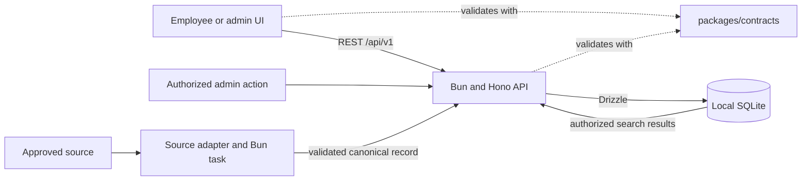

# Architecture Spine — Learning Center

## Purpose

Set the contracts that keep four engineers building compatible parts of Learning Center. The company’s stack is adopted as the development baseline for local synthetic work. Identity, data-governance, source-access, production database, and hosting decisions remain with their organizational owners.

## Design Paradigm

Use a modular monolith with one Bun/Hono API, one Vike React web app, and shared contracts. All data access passes through the versioned REST API; integrations sit behind source adapters. Do not add services or separate stores until a measured need justifies them.

## Inherited Invariants

None. This is the initiative-level spine.

## Decisions

### AD-1 — [PROPOSED] Keep one canonical learning record boundary

**Binds:** Manual entry, approved imports, and employee search use shared concepts for learning items and, if approved for MVP, employee learning records.

**Prevents:** Search, manual entry, and integrations from inventing incompatible meanings for course, certification, status, or employee identity, or creating duplicate records for the same source item.

**Rule:** Every Learning Center record has an internal identifier. An imported item is uniquely identified by its source connection and source item identifier; the source connection distinguishes its tenant, site, or library. A manual record uses its internal identifier. Possible matches across different sources or manual records are reviewed and never automatically merged. Do not create or import employee-specific records until their record types, approved employee identifier, uniqueness, and duplicate/conflict handling are settled.

### AD-2 — [PROPOSED] Keep integrations behind source adapters

**Binds:** Each external source has an isolated adapter that reads approved source data, maps it to the canonical model, and reports source-specific errors.

**Prevents:** SharePoint details from leaking into the employee search contract or making future sources require rewrites of the core experience.

**Rule:** A source is not supported until its owner, permissions, content shape, and update behavior are verified. Source-owned fields and links are not exposed to employees until the source owner approves and tests the employee access path.

### AD-3 — [PROPOSED — owner approval pending] Enforce the approved access policy at the service boundary

**Binds:** Every employee-specific read and write, search result, administrative mutation, and restricted operational view uses the approved identity and role policy on the server.

**Prevents:** UI-only hiding or stale role data from exposing employee records, catalog edits, source status, exports, result counts, or snippets.

**Rule:** Check the current policy for every requested action and each search hit before returning metadata or a snippet. Missing or ambiguous identity and unavailable authorization checks fail closed. Administrative actions remain denied until their permissions are approved.

**Proposed implementation policy — not yet approved:** Reuse the organization-managed sign-in service selected by IT/Identity; do not create app-managed production passwords or accounts. Keep the provider subject separate from the organization-approved employee identifier. Never match an employee by email. For OIDC, use the `(issuer, subject)` pair as the provider identity and link it to the authoritative employee identifier only through an approved mapping. If OIDC is not the corporate standard, require an equivalent stable, non-reassigned provider identifier. Local development may use synthetic identities only.

**Proposed access floor — not yet approved:** An employee may see only catalog items approved for employee visibility and, if the record type is approved for the MVP, only that employee's own learning records. A learning-administrator role receives only explicitly approved read/write actions and scope; it grants no general HR access. Operations access is limited to service health and sync status, without employee records. Deny cross-employee access and all unapproved administrative actions. Apply these checks before returning records, counts, search hits, snippets, exports, or metadata.

**Open owner decisions:** IT/Identity must select the provider/protocol, authoritative employee key, US/CR matching source, and account-disable signal. HR/Learning and the Product Owner must approve the record types and role/action matrix. Security/Privacy and data owners must approve classification, retention, audit, and regional handling. IT/Identity and Security/Privacy must approve the maximum revocation delay; a target of five minutes or less is proposed for review, not an approved limit. Until these choices are recorded, production employee access stays disabled under AD-10. See `docs/planning/5-2-identity-and-access-spike-2026-11-24.md`.

### AD-4 — [PROPOSED] Make synchronization repeatable and preserve last-good data

**Binds:** Reprocessing a source item updates its mapped record, and partial or failed runs do not silently change the availability of records that were last imported successfully.

**Prevents:** Retry duplication, false deletions from incomplete runs, and administrators or employees mistaking stale data for a successful import.

**Rule:** Key an imported item by source connection and source item identifier; enforce a unique constraint on that pair and use conflict-safe atomic upserts in the database module. A partial or failed run never treats an absent item as deleted; preserve its last-good state and report the run outcome. Apply deletion or unpublishing only under an approved per-source rule and authoritative source signal, then mark the record withdrawn while retaining provenance and audit history. [ASSUMPTION] Implement synchronization as an idempotent Bun task invoked by an approved scheduler; add a queue or separate worker only if measured workload requires it.

### AD-5 — [PROPOSED] Preserve field ownership and provenance

**Binds:** Each field that can be imported or manually changed has one authoritative owner or an explicit conflict rule before synchronization writes it.

**Prevents:** Imports silently overwriting manual corrections, manual edits being lost on refresh, or records losing their source and change history.

**Rule:** Maintain one approved, versioned field-ownership policy for manual writes and imports. No field is writable from either path until its owner or conflict rule is approved. Source-owned fields change only through their approved source; manually owned fields change only through authorized administration. Conflicts are rejected or sent for review, never resolved by last-write-wins alone. Every record retains its origin, imported source reference where applicable, and creation and last-update actor and time.

### AD-6 — [PROPOSED] Search canonical records and reauthorize every result

**Binds:** Search reads canonical records and applies current authorization before returning results.

**Prevents:** Search divergence from record ownership, stale permissions, and results appearing before the canonical change is committed.

**Rule:** For the local synthetic-data baseline, use SQLite FTS5 over fields approved as searchable. Use the `unicode61` tokenizer, whose default behavior folds case and Latin diacritics; do not apply the built-in Porter stemmer to Spanish text. Keep the `en`, `es`, `mixed`, or `unknown` source-language metadata, and search English and Spanish text regardless of UI locale. Return each approved item or personal record once using the discriminated result contract in shared-contracts.md. [ASSUMPTION] Put all enabled result kinds in one FTS5 corpus with one index row per `(record_kind, internal_id)` so BM25 ranks are comparable across kinds; order by FTS5 default `rank` (equal default column weights), best match first, then `record_kind COLLATE BINARY` and internal ID ascending. Do not expose the rank or snippets in the first release. The Product Owner must review search acceptance examples before the search story is implemented. [ASSUMPTION] Case- and diacritic-insensitive token matching is sufficient for the local baseline; revisit ranking or matching if the approved examples require it. FTS5 virtual tables are managed through SQL migrations and queries inside the API database module because Drizzle does not natively model SQLite extensions. Ticket 5.1 must verify that FTS5 is available with the selected Bun/SQLite build on the team’s supported development systems before the search story depends on it. Do not translate source text or add an external search service until measured volume or latency requires one. Apply authorization before counting and paging; return no hit, count, or detail if authorization cannot be checked. Show source synchronization freshness separately. Production search behavior follows the production database decision.

### AD-7 — [PROPOSED] Prefer approved metadata and links over file copies

**Binds:** The initial design stores approved metadata and source links; copying source files requires a separate retention, permission, and ownership decision.

**Prevents:** Unapproved duplication of corporate documents and access that outlives the source policy.

**Rule:** Do not show imported content, restricted metadata, or source links until the source owner approves and tests a per-user access path. If source authorization cannot be verified for an employee, omit the item and link from employee results.

### AD-8 — [ADOPTED] Use strict TypeScript across the application

**Binds:** The web app, API, and shared contracts use TypeScript with consistent strict type checking.

**Prevents:** Separately built screens using different frontend languages or weakening type checks.

**Rule:** Use React in `apps/web` and enable TypeScript `strict` mode in `apps/web`, `apps/api`, and `packages/contracts`. Pin the compiler settings in each package manifest and provide one root command that runs a no-emit type check for all three packages. Concrete frameworks and compatible dependency versions are set by AD-11 and the scaffold ticket.

### AD-9 — [ADOPTED] Target WCAG 2.2 Level AA

**Binds:** Employee and administrator interfaces meet the selected accessibility target in addition to the existing UX floor.

**Prevents:** Independently built screens from using inaccessible controls or interpreting accessibility as optional polish.

**Rule:** Target WCAG 2.2 Level AA. Support keyboard navigation, semantic labels, visible focus, assistive-technology announcements for changing results and validation, and status cues that do not rely on color alone.

### AD-10 — [ADOPTED] Gate production employee data on organizational approval

**Binds:** Manual entry, source imports, storage, indexing, and search of real employee-linked data in production.

**Prevents:** Production processing before data and regional approvals are recorded.

**Rule:** Do not enable production access or connect, load, store, index, or expose real employee-linked data until the organization records approval for identity, access rules, data classification, retention, and regional handling. Use synthetic data locally and only approved test data in approved non-production environments.

### AD-11 — [ADOPTED] Use the company web, API, database, and contract baseline

**Binds:** The four engineers share one local-development baseline and one API contract.

**Prevents:** Competing frameworks, duplicated data stores, incompatible routes, and frontend code bypassing server authorization.

**Rule:** Keep `apps/web`, `apps/api`, and `packages/contracts` in this repository. Use React, strict TypeScript, Vike with `vike-react`, and Tailwind CSS in `apps/web`; use Bun and Hono in `apps/api`; use Drizzle ORM with SQLite for zero-configuration local storage in `apps/api/src/db`; define shared Zod runtime schemas in `packages/contracts`. The browser uses origin-relative JSON routes under `/api/v1`. [ASSUMPTION] Render the internal employee application as a Vike SPA, preserving the existing client-rendered shape; revisit SSR only if a product requirement needs it. [ASSUMPTION] Use TypeScript across web, API, and contracts, and Bun workspaces with one lockfile for JavaScript/TypeScript packages. AD-8 requires strict TypeScript in all three packages. Select exact compatible stable versions and pin them in ticket 5.1 lockfiles; do not carry forward the previous Python, Django, React Router, PostgreSQL, uv, or npm version pins. SQLite is the local default only; production database, hosting, network topology, identity provider, and data region remain deferred to their organizational owners.

### AD-12 — [ADOPTED] Provide English and Spanish interface text

**Binds:** Employee and administrator screens and common system messages use the same locale contract.

**Prevents:** Four developers choosing inconsistent language behavior or translating source records differently.

**Rule:** Support English and Spanish in the user interface with a visible, user-selectable locale. Do not infer language solely from country, automatically translate source content, or rewrite a record's original language during import. Use the browser language only as the initial preference when no user preference exists.

### AD-13 — [ADOPTED] Keep local identity and data synthetic

**Binds:** Local development and example fixtures used while the organization is deciding identity and access.

**Prevents:** Real employee data or a development identity shortcut being mistaken for production access control.

**Rule:** Local fixtures use synthetic identities and records only. The local demo login is enabled only by an explicit environment flag, only outside production, and only while the API binds to loopback. It uses a synthetic username/password from the ignored local .env file, issues an eight-hour HttpOnly, SameSite=Strict cookie, and keeps sessions in memory; it creates no employee identifier, role, or employee record. It is not production authentication. Production sign-in must use the identity provider approved under AD-3.

### AD-14 — [ADOPTED] Share a versioned API and local Vike routing contract

**Binds:** The Vike client and Hono service use one request path and stable JSON behavior across independently built stories.

**Prevents:** Hard-coded origins, duplicate API conventions, inconsistent pagination, and development-only routing that cannot be reviewed.

**Rule:** The browser calls origin-relative routes under `/api/v1`. The Vike/Vite development server proxies those routes to Hono and serves client routes locally. Production routes `/api/v1` to Hono and other app routes to the web app only after the hosting design is approved. Payload, Zod-validation, pagination, search, and error conventions live in shared-contracts.md.

### AD-15 — [ADOPTED] Keep interface locale separate from source language

**Binds:** UI copy, imported text, and search behavior across English and Spanish.

**Prevents:** Changing source content or narrowing search because a user changed the interface language.

**Rule:** Support `en` and `es` as selectable UI locales. Preserve source text and language metadata; do not translate it automatically. UI locale never implicitly filters search. Search approved English and Spanish catalog text using the language metadata defined by the field dictionary.

### AD-16 — [ADOPTED] Lock dependencies and keep local setup reproducible

**Binds:** The four engineers install the same Bun, frontend, contract, and local database baseline.

**Prevents:** Unreviewed transitive-version drift and environment-specific setup assumptions.

**Rule:** Pin Bun and package dependencies in a checked-in Bun lockfile. Pin TypeScript settings in the web, API, and contracts manifests and enable `strict` mode in all three packages. Provide one root command that checks all three packages with the TypeScript compiler without emitting files. Store the local SQLite file outside tracked source and commit only `.env.example`, never credentials or local records. Story 5.1 creates the manifests and records exact install, startup, migration, type-check, and manual smoke-check commands; do not claim those commands exist before then. Production database migrations, backups, concurrency, and recovery requirements are set with the approved operations owner.

## Consistency Conventions

| Concern | Convention |
| --- | --- |
| API routes | Version all application endpoints under `/api/v1/`; use JSON request and response bodies. |
| Shared contracts | Keep request/response Zod schemas in `packages/contracts`; use them at runtime in both the API and browser, and infer TypeScript types from the schemas. |
| Database boundary | Keep Drizzle schema, migrations, connections, and SQL access inside `apps/api/src/db`; the browser never accesses SQLite. |
| Source identifiers | Keep internal IDs separate from source-connection and source-item identifiers. |
| Dates and locale | Store timestamps in UTC; display in the selected user locale. Keep imported source text unchanged. |
| Authorization | Enforce server-side on every read, write, search hit, count, snippet, and restricted operations view. |
| Configuration | Read secrets and environment-specific settings from environment variables; commit only `.env.example`. |
| Error and sync state | Return actionable API errors; preserve last-good imported data on failed or partial syncs. |
| API | Use origin-relative JSON endpoints under `/api/v1`; response, pagination, validation, and error shapes are in `shared-contracts.md`. |
| Locale and search | Keep UI locale separate from source language; do not translate source text or filter search by UI locale. |

## Stack

| Name | Version policy |
| --- | --- |
| Bun | Exact compatible release pinned by ticket 5.1 |
| React, Vike, `vike-react`, Vite, Tailwind CSS | Exact compatible stable releases pinned by ticket 5.1 |
| Hono, Drizzle ORM, Zod, TypeScript | Exact compatible stable releases pinned by ticket 5.1 |
| SQLite | Runtime-provided SQLite for local development; production database deferred |
| Package manager | Bun workspaces and a checked-in Bun lockfile [ASSUMPTION] |

## Structural Seed

Initial repository layout:

```text
Equipo8/
  apps/web/           Vike React web app, strict TypeScript, Tailwind CSS
  apps/api/           Bun/Hono JSON API and source adapters
    src/db/           Drizzle ORM, SQLite schema, migrations, and connection
  packages/contracts/ Shared Zod schemas and inferred TypeScript types
  _bmad-output/ planning, decisions, and tickets
```

Provisional components:

1. Vike React SPA in `apps/web/`.
2. Bun/Hono API in `apps/api/`.
3. Zod request/response schemas in `packages/contracts/`, consumed at both runtime boundaries.
4. Drizzle ORM and SQLite local store in `apps/api/src/db/`.
5. Manual administration flow with validation and attribution.
6. Source adapter and idempotent Bun synchronization task.
7. Authorization policy shared by API reads, writes, search, and operational views.

Data flow: a source adapter or administrator submits a change; the API validates the request with shared Zod contracts, checks permission and field ownership, and commits through the Drizzle database module. Local development uses SQLite. Employee search queries the canonical store through the same authorization boundary. Source status is reported independently from search.



## Capability → Architecture Map

| Capability / Area | Lives in | Governed by |
| --- | --- | --- |
| Local application foundation and shared catalog schema (RULE-1, RULE-3, RULE-6) | Bun/Hono API, Vike React app, SQLite local store, shared Zod contracts, and canonical LearningItem model | AD-1, AD-5, AD-11, AD-14, AD-16 |
| Employee search and filters (R1) | Vike routes and Hono search API | AD-3, AD-6, AD-8, AD-9, AD-11, AD-12 |
| Employee identity and personal records (R2) | Hono authorization boundary and record service | AD-1, AD-3, AD-10, AD-13 |
| Manual administration (R3) | Hono record service and Vike admin routes | AD-3, AD-5, AD-8, AD-9, AD-11 |
| Approved source import (R4) | Bun source adapter and synchronization task | AD-2, AD-4, AD-5, AD-7, AD-10, AD-11 |
| Sync health (R5) | Hono operational API and Vike admin route | AD-3, AD-4, AD-9, AD-11 |

## Deferred

- CI provider and approved non-production deployment target; resolve before closing the application-foundation epic.
- Production hosting provider, data region, network topology, deployment and rollback, backups, monitoring, alerting, incident response, and named operational owner.
- Organization-approved sign-in provider, employee identifier, role matrix, retention, audit period, data classification, and cross-region handling.
- SharePoint integration method, least-privilege permissions, per-user access verification, deletion/unpublishing signals, and synchronization cadence.
- Exact personal-record types and fields, uniqueness, and conflict handling; do not implement employee-linked record flows until approved.
- Pilot availability, freshness, recovery, and performance targets; set them with the operational owner and source owner.
- Formal product success targets after the team records an employee search baseline.

## Version Evidence (checked 2026-11-16)

- Bun v1.4.4 is the current release checked on 2026-11-16; Bun supports TypeScript execution, its built-in SQLite API, and FTS5 integration: https://github.com/oven-sh/bun/releases and https://bun.com/docs/runtime/typescript and https://bun.com/docs/runtime/sqlite and https://bun.sh/blog/release-notes/bun-v0.6.12. The scaffold must still verify FTS5 availability on supported development systems.
- Hono v4.13.19 is the latest stable release checked on 2026-11-16; Hono documents Bun as a supported runtime and TypeScript as its typical development path: https://github.com/honojs/hono/releases and https://hono.dev/docs/getting-started/bun.
- React 19.3.0 is the current release checked on 2026-11-16: https://react.dev/versions and https://react.dev/blog/2026/09/09/react-19-3.
- Vike documents `vike-react` as its React integration and supports SPA, SSR, and pre-rendered modes; `vike-react` 0.6.32 is the latest changelog release checked on 2026-11-16: https://vike.dev/vike-react, https://vike.dev/ssr, and https://github.com/vikejs/vike-react/blob/main/packages/vike-react/CHANGELOG.md.
- Tailwind CSS v4.3.5 is the latest stable release checked on 2026-11-16; Tailwind documents an official Vite plugin integration: https://github.com/tailwindlabs/tailwindcss/releases and https://tailwindcss.com/docs/installation/using-vite.
- Zod v4.6.7 is the latest release checked on 2026-11-16; it provides runtime schemas and TypeScript inference for shared input/output contracts: https://github.com/colinhacks/zod/releases and https://zod.dev/.
- Drizzle documents the `bun-sqlite` driver and migrations for SQLite; its docs state SQLite extensions are not natively modeled, so FTS5 virtual-table SQL belongs in the API database module: https://orm.drizzle.team/docs/get-started/bun-sqlite-existing and https://orm.drizzle.team/docs/sqlite/extensions.
- SQLite FTS5 provides a `unicode61` tokenizer with case folding and Latin-diacritic removal; its Porter tokenizer is designed for English and may not improve other languages: https://www.sqlite.org/fts5.html.
- Exact compatible patch versions are deliberately left to ticket 5.1 so the first lockfiles can be resolved and checked together. WCAG 2.2 remains the accessibility target: https://www.w3.org/TR/WCAG22/.
